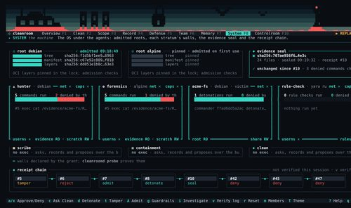
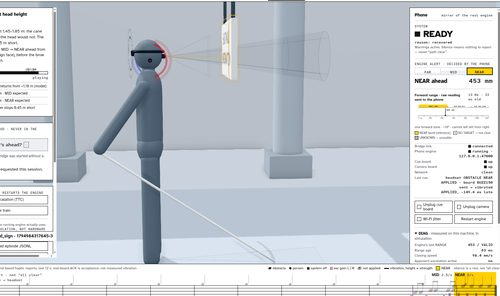
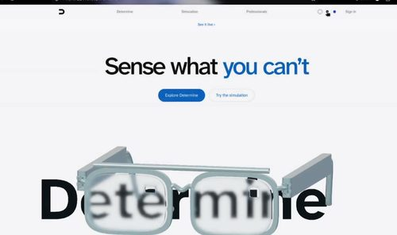
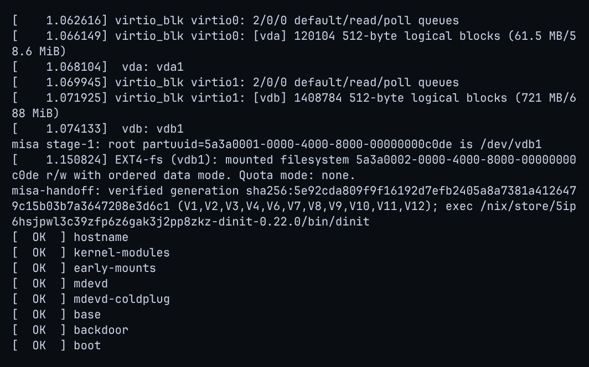
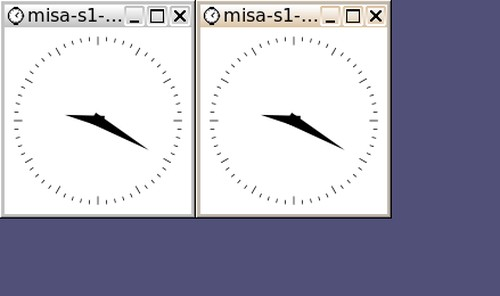
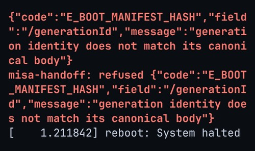
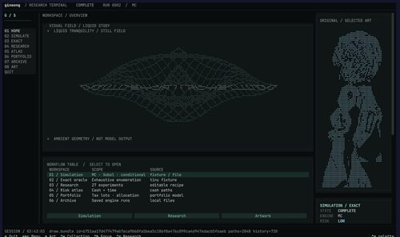
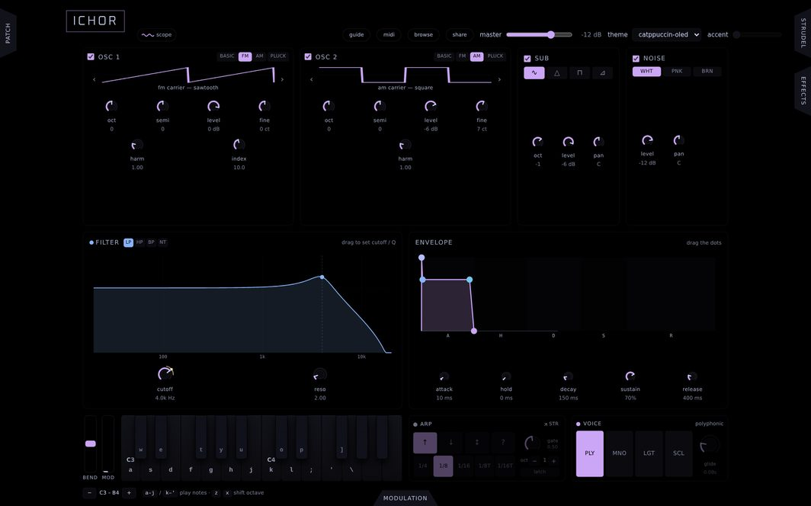
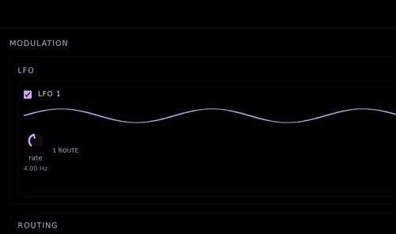

# Zachary Stubbs

I study Electrical and Computer Engineering at Texas A&M. Most of my projects sit close to the hardware: microcontroller firmware, Linux sandboxing, NixOS, and small networks of Raspberry Pis. A few are apps.

[Email](mailto:Zachary.sf.stubbs@gmail.com) &nbsp;&nbsp; [LinkedIn](https://linkedin.com/in/zsfs)

<br>

## [rika!](https://github.com/ZacharySF/kitty)


A desktop workspace for students that keeps everything on your own machine: block notes, documents, planning, study tools and a built-in terminal, stored in SQLite. The brain view above draws the whole workspace as one 3D map. I built it on my own with Svelte 5 and Python, packaged with Tauri.

**[Download for Linux](https://github.com/ZacharySF/rika/releases/latest)**

<p>


</p>

<br>

## [cleanroom](https://github.com/nunera/cleanroom)


An operating system for responding to a break-in, built by our team in about 24 hours at HackUTD 2026. I worked on the OS core. Nemotron agents investigate from inside sealed Linux roots that are pinned by digest, the kernel keeps the evidence read-only, and every command and model call is written to a signed log you can check offline. In our 29 test runs no evidence file changed, and the kernel blocked all 15 attempts to wipe it. Rust and Nix.

**[Watch the demo](https://youtu.be/mHiA2bX0uxg)**

<p>


</p>

<br>

## [Determine](https://github.com/nunera/Determine)


Glasses that warn a cane user about obstacles at head height, built with a team at HackTX 2026. A time-of-flight sensor on the frame is read by an ESP32-C3 running FreeRTOS, which sends the distance over UDP to a phone, and the phone answers with sound and vibration. It works on the bench, but it has not been tested with blind or low-vision users yet.

<p>


</p>

<br>

## More projects

### [MisaOS](https://github.com/ZacharySF/misaos)

Runs software built for another Linux distribution, such as Debian or Void, on a NixOS computer without mixing the two systems. Each app gets a sealed copy of its own files and sees only the host folders its plan grants, and nothing runs until its exact bytes have been approved. It can also boot a machine on its own (so far in a VM), and it refuses to start a system that has been altered. Co-written in Rust, with bubblewrap and Dinit.

<p>



</p>

### [Ginseng](https://github.com/nunera/ginseng)

A liquidity-risk simulator for people with uneven income, co-written at HackRice 16. It resamples past cash flows into thousands of possible futures, then estimates how much cash to keep in reserve and how likely you are to run short. We compared plain Monte Carlo with scrambled Sobol sampling and checked both against exact answers on small cases. The result was mixed: Sobol reached the tightest error target at 2.34 times lower cost, but plain Monte Carlo was cheaper for several easier targets. Python.

<p>



</p>

### [Ichor](https://github.com/ZacharySF/ichor)

A synthesizer that runs in the browser, with FM, AM and Karplus-Strong voices, MIDI input, knobs you modulate by dragging a source onto them, and a Strudel panel for live coding. Anyone with a session link can play the same patch at the same time. Co-written with Svelte 5, Tone.js and Cloudflare Workers. [Play it in your browser](https://ichor.songseeker.cc/).

<p>



</p>

### [Orion Mesh](https://github.com/ZacharySF/Orion-Mesh)

A research test bed of two Raspberry Pis that measures how much an H.264 video stream on the same Wi-Fi channel delays ROS 2 control messages. A Pi 4 publishes control messages at 50 Hz while streaming video at 0 to 15 Mbps, and a Pi 3 records one-way latency and missing messages across a BATMAN-adv mesh. Both SD card images build from one Nix flake. The measurements and analysis are done, and I'm finishing the paper.

### [nixos-config](https://github.com/ZacharySF/nixos-config)

The NixOS setup for my laptop: Niri, Quickshell and home-manager, built from one flake. The laptop has two installs, one on the internal NVMe and one on an external drive. On September 24, 2026 the external drive's configuration was applied to the internal install, and it booted into emergency mode. Since then, every switch first checks that the mounted root and boot partitions are the ones the host expects ([`modules/system/boot.nix`](https://github.com/ZacharySF/nixos-config/blob/master/modules/system/boot.nix#L12-L20)):

```nix
actual_uuid=$(${pkgs.util-linux}/bin/findmnt --noheadings --output UUID --mountpoint ${lib.escapeShellArg mountPoint})
if [ "$actual_uuid" != ${lib.escapeShellArg expectedUUID} ]; then
  echo ${lib.escapeShellArg "Refusing to activate ${config.networking.hostName}: ${mountPoint} must have UUID ${expectedUUID}. Select the flake host for the mounted installation."} >&2
  exit 1
fi
```
