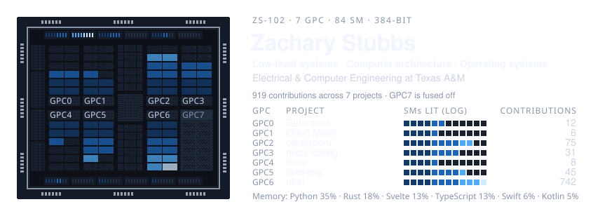
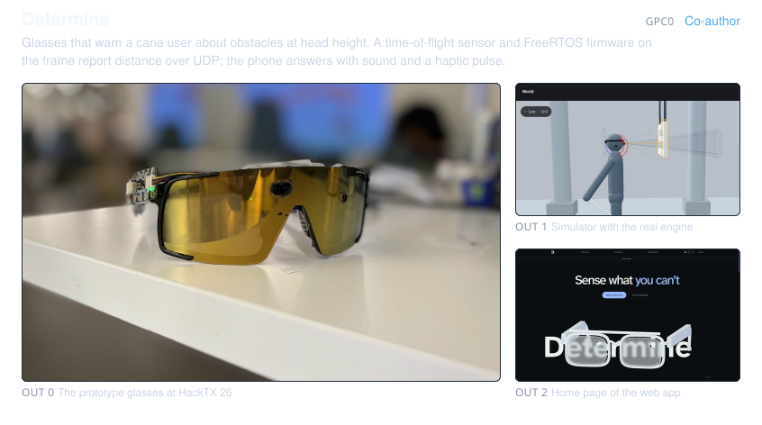
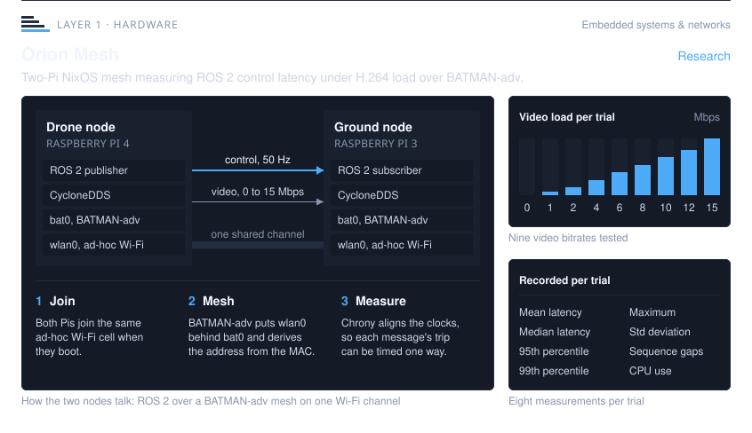
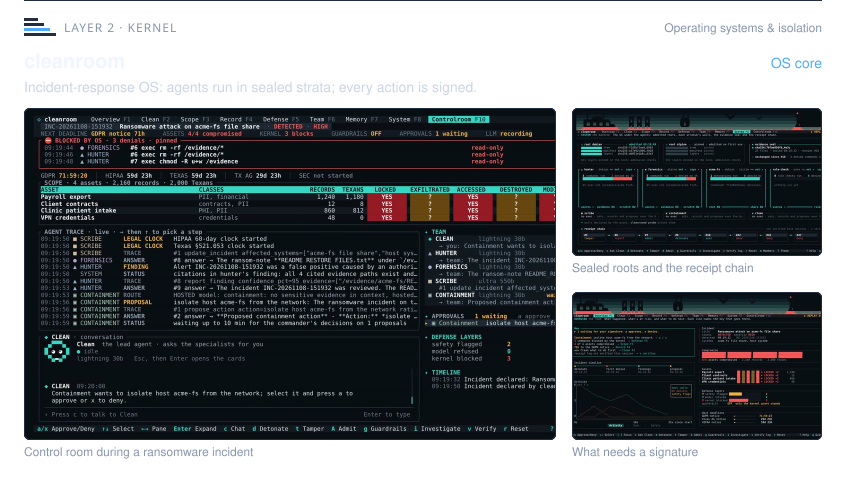
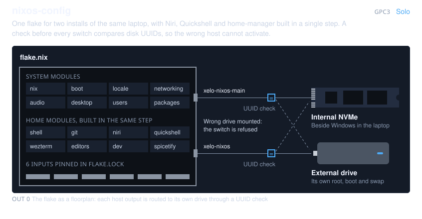
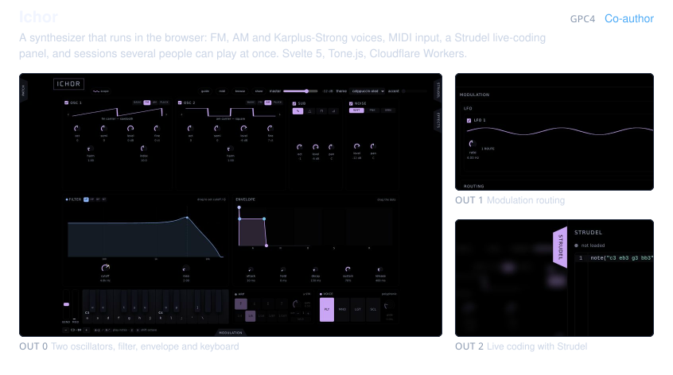
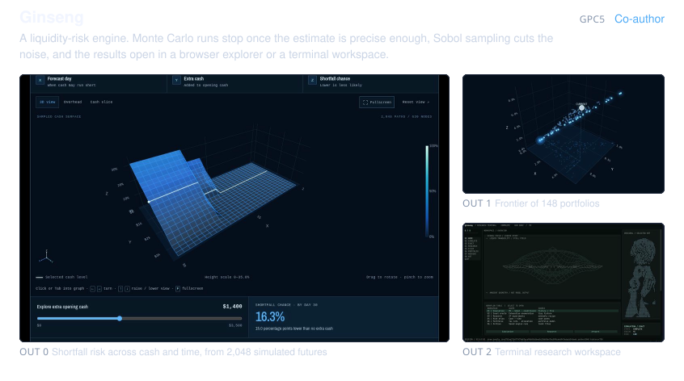
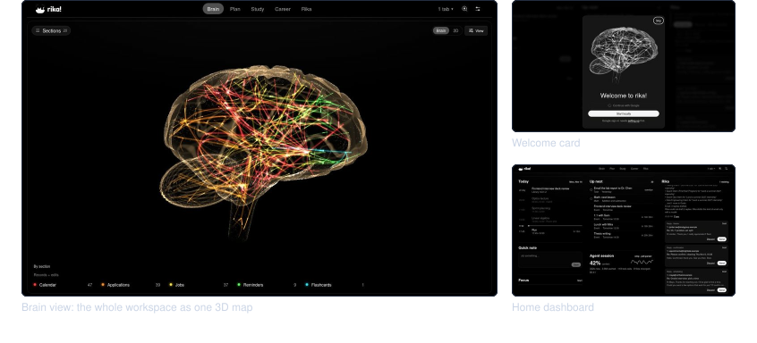
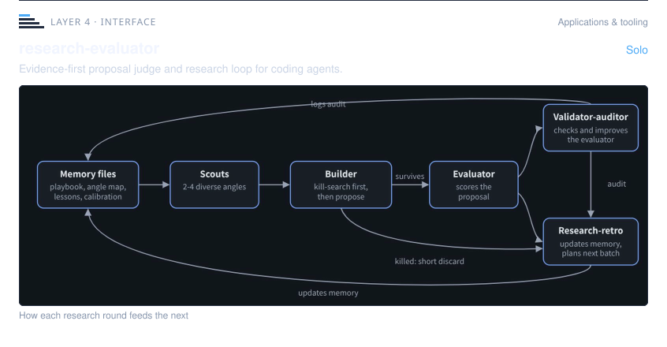
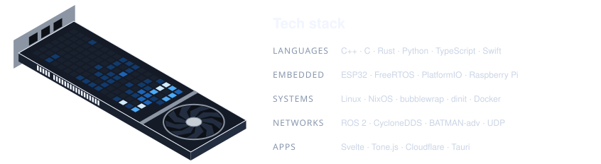

  <picture><source media="(prefers-color-scheme: light)" srcset="assets/hero-light.svg"></picture>

<!-- One block per project, hardware first. Generated by scripts/build-assets.mjs from scripts/projects.mjs; pictures live in assets/shots. -->

  <a href="https://github.com/nunera/Determine"><picture><source media="(prefers-color-scheme: light)" srcset="assets/projects/determine-light.svg"></picture></a>
  <a href="https://github.com/ZacharySF/Orion-Mesh"><picture><source media="(prefers-color-scheme: light)" srcset="assets/projects/orion-mesh-light.svg"></picture></a>
  <a href="https://github.com/nunera/cleanroom"><picture><source media="(prefers-color-scheme: light)" srcset="assets/projects/cleanroom-light.svg"></picture></a>
  <a href="https://github.com/ZacharySF/nixos-config"><picture><source media="(prefers-color-scheme: light)" srcset="assets/projects/nixos-config-light.svg"></picture></a>
  <a href="https://github.com/ZacharySF/ichor"><picture><source media="(prefers-color-scheme: light)" srcset="assets/projects/ichor-light.svg"></picture></a>
  <a href="https://github.com/nunera/ginseng"><picture><source media="(prefers-color-scheme: light)" srcset="assets/projects/ginseng-light.svg"></picture></a>
  <a href="https://github.com/ZacharySF/kitty"><picture><source media="(prefers-color-scheme: light)" srcset="assets/projects/rika-light.svg"></picture></a>
  <a href="https://github.com/ZacharySF/research-evaluator"><picture><source media="(prefers-color-scheme: light)" srcset="assets/projects/research-evaluator-light.svg"></picture></a>

  <a href="https://ichor.songseeker.cc/">Play Ichor in your browser</a> ·
  <a href="https://github.com/ZacharySF/rika/releases/latest">Download rika!</a>

  

<!-- Generated by scripts/build-assets.mjs; scripts/card.mjs keeps the white contacts inset into the GPU side face. -->

  <picture><source media="(prefers-color-scheme: light)" srcset="assets/card-row-light.svg"></picture>

  

<h2 align="center">Contact</h2>

  <a href="mailto:Zachary.sf.stubbs@gmail.com">Email</a> ·
  <a href="https://linkedin.com/in/zsfs">LinkedIn</a>

