

  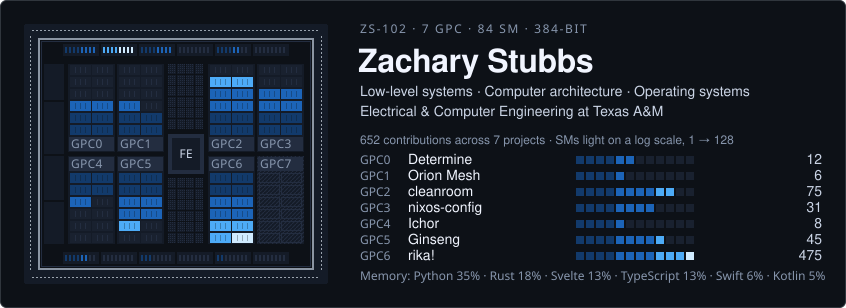

  General Engineering at Texas A&amp;M, on an electrical engineering path with a computer engineering focus. 
  Now strengthening C++ build and debugging fundamentals while moving into RTL and GPU systems work.

  

  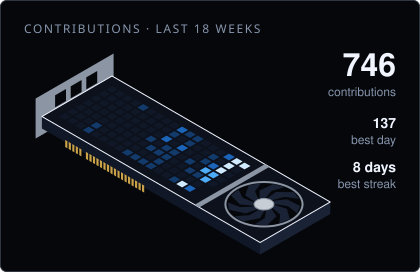

## Projects by layer

Ordered from the hardware up. Each layer lists the concepts the projects in it exercise.

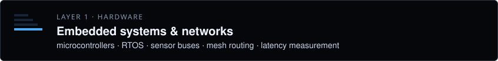

<a href="https://github.com/nunera/Determine">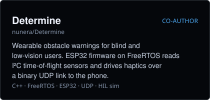</a> <a href="https://github.com/ZacharySF/Orion-Mesh">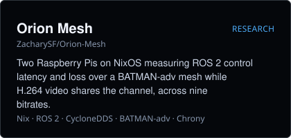</a>

<a href="https://github.com/nunera/cleanroom">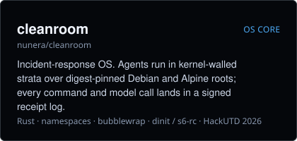</a> <a href="https://github.com/ZacharySF/nixos-config">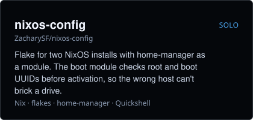</a>

<a href="https://github.com/ZacharySF/ichor">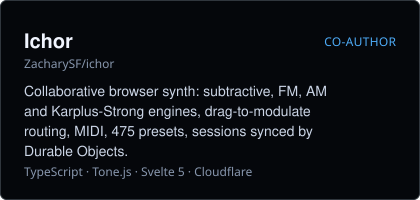</a> <a href="https://github.com/nunera/ginseng">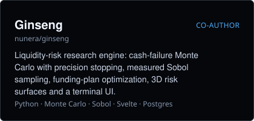</a>

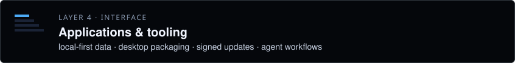

<a href="https://github.com/ZacharySF/kitty">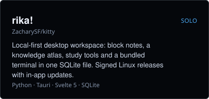</a> <a href="https://github.com/ZacharySF/research-evaluator">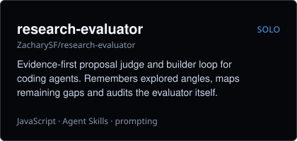</a>

[Play Ichor ↗](https://ichor.songseeker.cc/) · [Download rika! ↗](https://github.com/ZacharySF/rika/releases/latest) · [cleanroom demo ↗](https://youtu.be/mHiA2bX0uxg)

## Tech stack

  

Also: FreeRTOS · ESP32 · PlatformIO · CycloneDDS · BATMAN-adv · bubblewrap · Tone.js · Gradle

## Contact

[LinkedIn ↗](https://linkedin.com/in/zsfs) · [Email ↗](mailto:Zachary.sf.stubbs@gmail.com)
