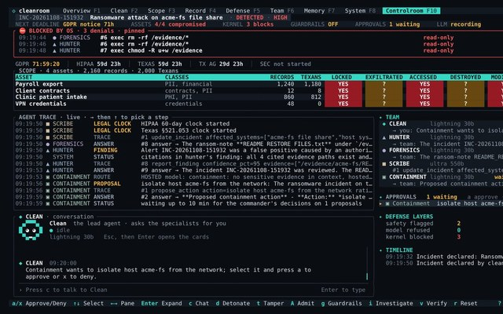
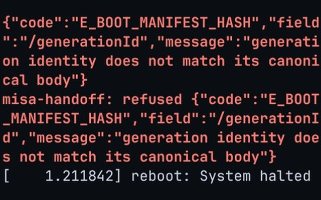
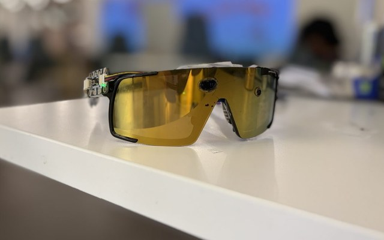
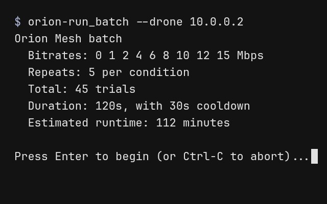
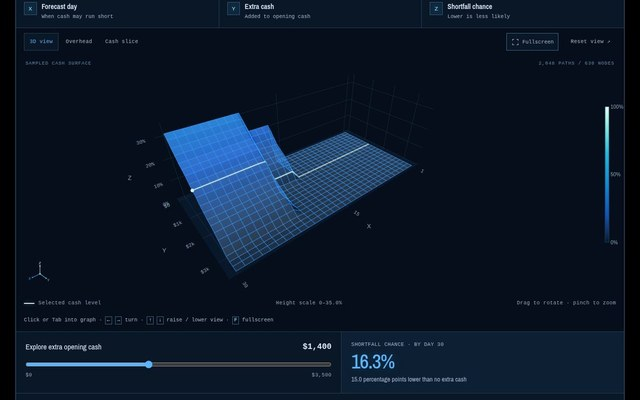
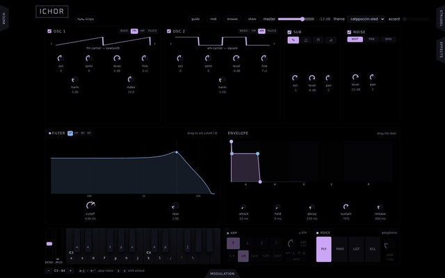
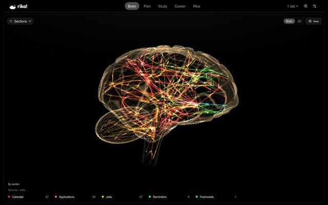

# Zachary Stubbs

I study Electrical and Computer Engineering at Texas A&M. Most of my projects sit close to the hardware: microcontroller firmware, Linux sandboxing, NixOS, and small networks of Raspberry Pis. A few are apps.

[Email](mailto:Zachary.sf.stubbs@gmail.com) &nbsp;&nbsp; [LinkedIn](https://linkedin.com/in/zsfs)

## Operating systems

### [cleanroom](https://github.com/nunera/cleanroom)

An operating system for investigating a break-in. Nemotron agents work inside sealed Linux roots, the kernel keeps the evidence read-only, and every action lands in a signed log. In 29 test runs no evidence changed, and all 15 wipe attempts were blocked.

Team project at HackUTD 2026; I worked on the OS core. Rust and Nix. [Demo video](https://youtu.be/mHiA2bX0uxg)

 

### [MisaOS](https://github.com/ZacharySF/misaos)

Runs apps from other Linux distributions, like Debian or Void, on NixOS without mixing the two. Each app gets a sealed copy of its files and sees only the folders it's granted. Nothing runs until its exact bytes are approved, and an altered system is refused at boot.

Co-author. Rust, bubblewrap and Dinit.

 

### [nixos-config](https://github.com/ZacharySF/nixos-config)

The NixOS setup for my laptop: Niri, Quickshell and home-manager from one flake. The laptop has two installs, and applying the wrong one's config once left it in emergency mode, so now every switch [checks the disk UUIDs first](https://github.com/ZacharySF/nixos-config/blob/master/modules/system/boot.nix#L12-L20) and refuses the wrong host.

Solo. Nix and QML.

 

## Hardware and networking

### [Determine](https://github.com/nunera/Determine)

Glasses that warn a cane user about obstacles at head height. A time-of-flight sensor on the frame feeds an ESP32-C3, and a phone turns the distance into sound and vibration. It works on the bench but hasn't been tried with blind or low-vision users yet.

Co-author, HackTX 2026. C and C++ firmware, Kotlin and Swift apps.

 

### [Orion Mesh](https://github.com/ZacharySF/Orion-Mesh)

Two Raspberry Pis on a BATMAN-adv mesh, used to measure how much an H.264 video stream on the same Wi-Fi channel delays ROS 2 control messages sent at 50 Hz. Both SD card images build from one Nix flake. The measurements are done and I'm writing the paper.

Research project. Python, ROS 2 and Nix.

 

## Apps and tools

### [Ginseng](https://github.com/nunera/ginseng)

A liquidity-risk simulator for people with uneven income. It turns past cash flows into thousands of possible futures and estimates how much cash to hold back. We checked Monte Carlo and Sobol sampling against exact answers: Sobol hit the hardest target at 2.34 times lower cost, but lost on easier ones.

Co-author, HackRice 16. Python and Svelte.

 

### [Ichor](https://github.com/ZacharySF/ichor)

A synthesizer that runs in the browser, with FM, AM and Karplus-Strong voices, MIDI input, knobs you modulate by dragging a source onto them, and a Strudel panel for live coding. Anyone with a session link can play the same patch at the same time.

Co-author. Svelte 5, Tone.js and Cloudflare Workers. [Play it](https://ichor.songseeker.cc/)

 

### [rika!](https://github.com/ZacharySF/kitty)

A desktop workspace for students that keeps everything on your own machine: block notes, documents, planning, study tools and a terminal, all in SQLite. The brain view draws the whole workspace as one 3D map.

Solo. Svelte 5, Python and Tauri. [Download for Linux](https://github.com/ZacharySF/rika/releases/latest)

 
