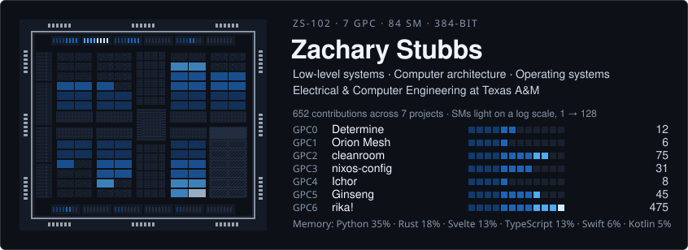
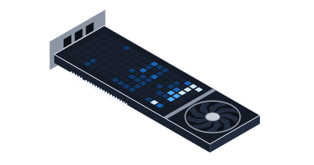
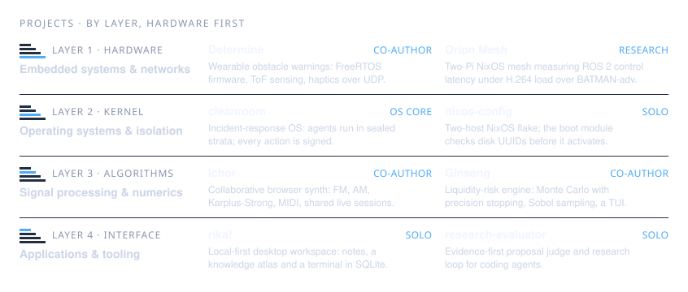

  

  
   
  

  

  <a href="https://github.com/nunera/Determine">Determine</a> ·
  <a href="https://github.com/ZacharySF/Orion-Mesh">Orion Mesh</a> ·
  <a href="https://github.com/nunera/cleanroom">cleanroom</a> ·
  <a href="https://github.com/ZacharySF/nixos-config">nixos-config</a> ·
  <a href="https://github.com/ZacharySF/ichor">Ichor</a> (<a href="https://ichor.songseeker.cc/">play</a>) ·
  <a href="https://github.com/nunera/ginseng">Ginseng</a> ·
  <a href="https://github.com/ZacharySF/kitty">rika!</a> (<a href="https://github.com/ZacharySF/rika/releases/latest">download</a>) ·
  <a href="https://github.com/ZacharySF/research-evaluator">research-evaluator</a>

<h2 align="center">Contact</h2>

  <a href="mailto:Zachary.sf.stubbs@gmail.com">Zachary.sf.stubbs@gmail.com</a> ·
  <a href="https://linkedin.com/in/zsfs">LinkedIn</a> ·
  <a href="https://github.com/ZacharySF">GitHub</a>

